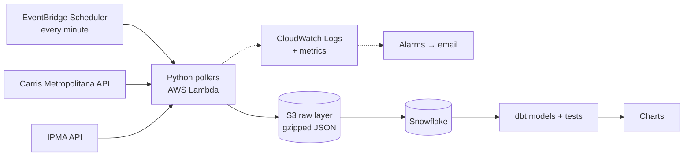

# 🚌 Is My Bus Late Again? — Carris Metropolitana × Weather

> **How often are Carris Metropolitana buses late, and does the weather make it worse?**

## The story so far

As an everyday Carris Metropolitana passenger, and a frequent complainer about how late the buses are, I decided to put my data engineering skills to use and finally answer the question that's been on my mind at every bus stop. With a small twist: does the weather make it worse?

With the question in mind, all that was left was to start building. I split the project into six phases, each one taking the data a step closer to an answer.

| Phase | What it covers | Status |
|---|---|---|
| 1 — Data & Tools Recon | Exploring the APIs, choosing the stack | ✅ Done |
| 2 — Laying the Foundations | AWS infrastructure with Terraform | ✅ Done |
| 3 — Catching the Data | Python pollers landing raw data in S3 | 🚧 In progress — vehicles live since 26 Oct 2026 |
| 4 — Into the Warehouse | Loading S3 into Snowflake | ⏳ Planned |
| 5 — Making Sense of It | dbt models and data quality tests | ⏳ Planned |
| 6 — The Verdict | Charts and answers | ⏳ Planned |

Every finding and design choice along the way is logged in [`docs/decisions.md`](docs/decisions.md).

---

## Phase 1 — Data & Tools Recon 🔍

*Before writing a single line of code, I needed to know what I was working with.*

**The data.** Both sources are public APIs:
- **Carris Metropolitana** — live vehicle positions, stops, lines, service metrics and a GTFS schedule feed: [api.carrismetropolitana.pt/v2](https://api.carrismetropolitana.pt/v2)
- **IPMA** (Portuguese Institute for Sea and Atmosphere) — hourly weather observations from its station network: [api.ipma.pt](https://api.ipma.pt)

**The tools.** Part of the stack is what I use every day at work: **Python, SQL, dbt and Snowflake**. Just as important is what's new for me:
- **AWS** (S3, Lambda, EventBridge) for data ingestion
- **Terraform** to build my own infrastructure from scratch
- My own **dbt project structure**, designed from the ground up
- **<!-- visualization tool -->** for presenting the results

**What the recon taught me.** The APIs didn't always behave the way the docs said, and a few discoveries changed the whole design:

- **The obvious endpoint didn't work.** `/arrivals` looked like exactly what I needed, but every past arrival I sampled had a null `observed_arrival`. So instead of asking the API when buses arrived, I work it out myself: poll every bus's live position each minute, catch the moment it's `STOPPED_AT` a stop, and compare that against the official GTFS timetable.
- **Timestamps lie (a little).** The docs describe vehicle timestamps as seconds in Lisbon time; they're actually UTC epoch milliseconds.
- **IDs are messier than documented.** Trip IDs carry bracketed plan prefixes like `[F34NX][YA15B]3512_0_1_...`. The good news: they join exactly to the GTFS feed, as long as I keep them untouched.
- **Weather has no memory.** IPMA only serves a rolling ~24 hour window with no archive. If I miss an hour, it's gone for good.
- **Lisbon weather isn't Carris weather.** Carris Metropolitana runs in the municipalities *around* Lisbon, not in the city itself. So each bus stop gets matched to its nearest IPMA station out of the 18 in the metro area, with a flag to exclude unrepresentative ones like the windy capes of Cabo da Roca and Cabo Raso.

---

## Phase 2 — Laying the Foundations 🏗️

*Every pipeline needs somewhere to live.*

This was my first time with AWS, so I wanted every piece of infrastructure written as code from day one: reproducible, reviewable, and easy to tear down. Everything lives in [`infra/`](infra/).

**Storage**
- A **raw-layer S3 bucket**, named with the AWS account ID suffix so it's globally unique without hard-coding the ID in a public repo
- **All public access blocked** and **encryption at rest** declared explicitly, even though the data itself is public. Least privilege applies to storage too.
- `force_destroy = false`, so Terraform refuses to delete the bucket while it holds data. Weeks of collection can't vanish with one bad command.

**Compute and scheduling**
- An **AWS Lambda** function running the vehicles poller, triggered **every minute** by **EventBridge Scheduler**
- A **kill switch** variable that pauses the schedule with one `terraform apply`, without deleting anything
- A CloudWatch log group owned by Terraform with **14-day retention** (Lambda's default is to keep logs forever, which quietly costs money)

**Security**
- **One IAM role per job, each with the bare minimum.** The poller can only write files under its own S3 prefix and its own logs; it can't read, list or delete anything. The scheduler can only invoke that one function, and only from my account.
- Authentication through an **AWS SSO profile**, so no long-lived keys sit on my laptop. In Lambda, the code picks up temporary credentials from its role, so there isn't a secret anywhere in the repo.

**Guardrails**
- A **$5/month budget alarm** that emails me on actual spend above 80% and, more usefully, on *forecast* spend above 100%, so I hear about a problem before the money is spent
- **Two CloudWatch alarms** that email me through SNS: one when the poller fails repeatedly, and a **heartbeat** for when it stops running at all (more on these below)
- **Default tags** on every resource, so it's always clear in the console (and on the bill) what belongs to this project
- Region **`eu-west-1`**, matching Snowflake to avoid cross-region transfer costs

**Next up:** move Terraform state into S3. It's local for now, which is fine for one person but not for CI.

---

## Phase 3 — Catching the Data 🎣

*Buses don't wait, and neither does the data.*

The ingestion code lives in [`ingestion/`](ingestion/). The rule is simple: **land every API response exactly as it arrived**. No cleaning, no reshaping; that's dbt's job later. If I ever get a transformation wrong, I can always replay it from the raw files.

**How it works:**
- Shared helpers handle HTTP fetching (with retries on network errors and 5xx, but not on 4xx, since retrying a bad request won't fix it), raw-layer file naming, and writing.
- Each response is **gzipped** and stored under **Hive-style partitions by UTC ingestion time**, one timestamped file per poll so a retry never overwrites or duplicates anything:
  ```
  raw/carris/vehicles/dt=2026-10-05/hour=17/vehicles_20261005T172800Z.json.gz
  ```
- The same code runs **locally** (writing to a `local_raw/` folder) or **in AWS** (writing to S3 when `RAW_BUCKET` is set), so I can test the whole job on my laptop without touching the cloud.
- Unit tests pin down the partition logic, including the classic trap of a Lisbon time timestamp landing in the wrong UTC day.

**Live since 26 October 2026:** the **vehicles poller**, the heart of the project, running on Lambda every minute.

- **Small and fast.** Python 3.12 on `arm64`, 256 MB of memory. Warm runs take under a second; most of that is waiting for the API.
- **No retries, on purpose.** If a run fails, retrying it later would only fetch a *newer* snapshot, never the missed one. So the next minute's run is the retry.
- **Rolled out carefully.** Deployed with the schedule switched off, tested with a manual invoke and the logs, and only then switched on.

**Measuring beat estimating, three times.**
1. The first run's logs showed memory peaking at 78% of 128 MB, so I doubled it. Runs then got twice as fast, because Lambda gives more CPU with more memory, so the compute cost stayed about the same.
2. A weekday morning returned **~1,200 buses (~1 MB per snapshot)**, three times what I'd seen while exploring. My exploration samples had been taken on a public holiday and a Saturday afternoon, both reduced-service days.
3. So I estimated daily volume from that rush-hour snapshot, and was wrong again, this time too high. At 3 a.m. there are only a handful of buses. The first full day measured **79 MB gzipped (~2.4 GB a month)**, about half my estimate.

Lesson learned: a sample from an unusual day, or an unusual hour, skews every estimate built on it. Measure whole cycles.

### Keeping an eye on it 🔭

A pipeline that runs unattended needs to tell me when it breaks, not wait for me to notice. Three layers:

| Layer | Question it answers | How |
|---|---|---|
| [`scripts/healthcheck.py`](scripts/healthcheck.py) | Is it working *right now*? | Six checks: schedule, deployed config, freshness, last-hour completeness, errors, spend. Exits 0 or 1, so it can run in CI later |
| [`scripts/audit_vehicles.py`](scripts/audit_vehicles.py) | How reliable *has* it been? | Per-day completeness, every gap over 90 s, extra runs, measured volumes |
| CloudWatch alarms → email | Tell me the moment it breaks | **Errors:** more than 5 failed runs in 15 minutes. **Heartbeat:** fewer than 10 runs in 15 minutes |

The heartbeat is the subtle one. If the schedule breaks, nothing runs, so nothing *fails*, and an errors alarm stays perfectly quiet. So the heartbeat watches for the **absence** of runs, and treats missing data as bad.

**First audit (26–28 Oct):** **100% of expected runs collected, zero gaps.** Average run ~0.5 s, 99th percentile ~2 s against a 60 s timeout, peak memory ~40% of 256 MB.

**The collection plan:**

| Data | Cadence | Why | Status |
|---|---|---|---|
| Vehicle positions | Every minute | Arrivals are derived from these, so resolution matters | ✅ Live |
| IPMA weather observations | Hourly, at :30 | No archive, and IPMA publishes with ~1 hour lag | ⏳ Next |
| Service delays | Every 15 min | Small, live endpoint | ⏳ Planned |
| Alerts | Every 30 min | Service disruptions | ⏳ Planned |
| Stops, lines, routes | Daily | Slowly changing dimensions | ⏳ Planned |
| Service metrics | Daily | Rolling 14 day window | ⏳ Planned |
| Demand by line | Weekly | Returns full history on every call (~48 MB) | ⏳ Planned |
| GTFS schedule | Landed as a zip | `stop_times.txt` alone is ~787 MB unzipped, too big to unpack inside Lambda | ⏳ Planned |

---

## Phase 4 — Into the Warehouse ❄️

*Getting raw files from S3 into Snowflake.*

**Coming soon.** <!-- Storage integration, external stage, COPY INTO / Snowpipe, raw tables. -->

---

## Phase 5 — Making Sense of It 🧩

*Raw data doesn't answer questions — models do.*

**Coming soon.** The plan is already shaped by Phase 1:

- **Arrivals:** turn minute by minute `STOPPED_AT` pings into arrival events, and join them to the GTFS timetable on `(trip_id, stop_id)`, watching out for loop routes that visit the same stop twice in one trip.
- **Delay:** actual arrival minus scheduled arrival. <!-- Define what counts as "late", e.g. more than X minutes. -->
- **Weather:** flatten IPMA's nested JSON, translate the Portuguese field names (`temperatura`, `precAcumulada`, …) to English, convert `-99` sentinels to nulls, and deduplicate the ~23 hours of overlap between consecutive polls.
- **Data quality:** dbt tests on things like timestamps falling within a plausible range.

<!-- dbt layers (staging → intermediate → marts) once the project is set up. -->

---

## Phase 6 — The Verdict 📊

*So… are the buses late? And is it the rain's fault?*

**Coming soon.** Data is being collected. 🕐

<!-- Charts and findings. How late on average, which lines/times are worst, and whether weather makes a difference. -->

---

## Architecture



## What it costs

Running the vehicles poller every minute (~43,000 runs a month) costs **well under $1 a month**, even before any free tier:

| Item | Rough monthly cost |
|---|---|
| S3 write requests (one file per minute) | ~$0.20 |
| CloudWatch alarms (2) | ~$0.20 |
| Lambda compute (256 MB, ~0.5 s per run) | ~$0.07 |
| EventBridge Scheduler invocations | ~$0.05 |
| S3 storage | cents, growing by ~2.4 GB a month (measured) |

The $5 budget alarm is there in case any of that turns out wrong. Actual spend after the first three days: about one cent.

## Running it yourself

**Prerequisites:** Python 3.12+, [uv](https://docs.astral.sh/uv/), Terraform ≥ 1.6, and an AWS account with an SSO profile that has a default region set (`aws configure set region eu-west-1 --profile <your-profile>`).

```bash
# Install dependencies
uv sync

# Run the tests
uv run pytest

# Run the vehicles poller locally (writes to ./local_raw)
PYTHONPATH=ingestion/src uv run python -m ingestion.carris_vehicles

# Log in to AWS
aws sso login --profile <your-profile>
export AWS_PROFILE=<your-profile>

# Budget alerts need an email; keep it out of git (*.tfvars is gitignored)
echo 'alert_email = "you@example.com"' > infra/terraform.tfvars

# Deploy the infrastructure
terraform -chdir=infra init
terraform -chdir=infra apply

# Send poller output to S3 instead of the local folder
export RAW_BUCKET=$(terraform -chdir=infra output -raw raw_bucket_name)
PYTHONPATH=ingestion/src uv run python -m ingestion.carris_vehicles

# Test the deployed Lambda once, then read its logs
aws lambda invoke --function-name "$(terraform -chdir=infra output -raw vehicles_function_name)" /tmp/out.json
aws logs tail "$(terraform -chdir=infra output -raw vehicles_log_group)" --since 10m

# Is everything healthy right now? (exit code 0 = all checks pass)
uv run python scripts/healthcheck.py

# How complete is the collected data, and how big is it?
uv run python scripts/audit_vehicles.py --since 2026-10-26T09:00

# Pause the every-minute schedule without deleting anything (kill switch)
terraform -chdir=infra apply -var vehicles_schedule_enabled=false
```