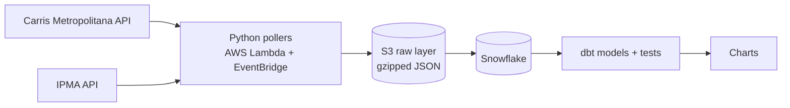

# 🚌 Is My Bus Late Again? — Carris Metropolitana × Weather

> **How often are Carris Metropolitana buses late, and does the weather make it worse?**

## The story so far

As an everyday Carris Metropolitana passenger, and a frequent complainer about how late the buses are, I decided to put my data engineering skills to use and finally answer the question that's been on my mind at every bus stop. With a small twist: does the weather make it worse?

With the question in mind, all that was left was to start building. I split the project into six phases, each one taking the data a step closer to an answer.

| Phase | What it covers | Status |
|---|---|---|
| 1 — Data & Tools Recon | Exploring the APIs, choosing the stack | ✅ Done |
| 2 — Laying the Foundations | AWS infrastructure with Terraform | 🚧 In progress |
| 3 — Catching the Data | Python pollers landing raw data in S3 | 🚧 In progress |
| 4 — Into the Warehouse | Loading S3 into Snowflake | ⏳ Planned |
| 5 — Making Sense of It | dbt models and data quality tests | ⏳ Planned |
| 6 — The Verdict | Charts and answers | ⏳ Planned |

Every finding and design choice along the way is logged in [`docs/decisions.md`](docs/decisions.md).

---

## Phase 1 — Data & Tools Recon 🔍

*Before writing a single line of code, I needed to know what I was working with.*

**The data.** Both sources are public APIs:
- **Carris Metropolitana** — live vehicle positions, stops, lines, service metrics and a GTFS schedule feed: [api.carrismetropolitana.pt/v2](https://api.carrismetropolitana.pt/v2)
- **IPMA** (Portuguese Institute for Sea and Atmosphere) — hourly weather observations from its station network: [api.ipma.pt](https://api.ipma.pt)

**The tools.** Part of the stack is what I use every day at work: **Python, SQL, dbt and Snowflake**. Just as important is what's new for me:
- **AWS** (S3, Lambda, EventBridge) for data ingestion
- **Terraform** to build my own infrastructure from scratch
- My own **dbt project structure**, designed from the ground up
- **<!-- visualization tool -->** for presenting the results

**What the recon taught me.** The APIs didn't always behave the way the docs said, and a few discoveries changed the whole design:

- **The obvious endpoint didn't work.** `/arrivals` looked like exactly what I needed, but every past arrival I sampled had a null `observed_arrival`. So instead of asking the API when buses arrived, I work it out myself: poll every bus's live position each minute, catch the moment it's `STOPPED_AT` a stop, and compare that against the official GTFS timetable.
- **Timestamps lie (a little).** The docs describe vehicle timestamps as seconds in Lisbon time; they're actually UTC epoch milliseconds.
- **IDs are messier than documented.** Trip IDs carry bracketed plan prefixes like `[F34NX][YA15B]3512_0_1_...`. The good news: they join exactly to the GTFS feed, as long as I keep them untouched.
- **Weather has no memory.** IPMA only serves a rolling ~24 hour window with no archive. If I miss an hour, it's gone for good.
- **Lisbon weather isn't Carris weather.** Carris Metropolitana runs in the municipalities *around* Lisbon, not in the city itself. So each bus stop gets matched to its nearest IPMA station out of the 18 in the metro area, with a flag to exclude unrepresentative ones like the windy capes of Cabo da Roca and Cabo Raso.

---

## Phase 2 — Laying the Foundations 🏗️

*Every pipeline needs somewhere to live.*

This was my first time with AWS, so I wanted every piece of infrastructure written as code from day one: reproducible, reviewable, and easy to tear down. Everything lives in [`infra/`](infra/).

**Built so far:**
- A **raw-layer S3 bucket**, named with the AWS account ID suffix so it's globally unique without hard-coding the ID in a public repo
- **All public access blocked** and **encryption at rest** declared explicitly, even though the data itself is public. Least privilege applies to storage too.
- **Default tags** on every resource, so it's always clear in the console (and on the bill) what belongs to this project
- Region **`eu-west-1`**, matching Snowflake to avoid cross-region transfer costs
- Authentication through an **AWS SSO profile**, so no long-lived keys sit on my laptop

**Next up:** the Lambda functions that run the pollers, their IAM roles, and EventBridge schedules to trigger them.

---

## Phase 3 — Catching the Data 🎣

*Buses don't wait, and neither does the data.*

The ingestion code lives in [`ingestion/`](ingestion/). The rule is simple: **land every API response exactly as it arrived**. No cleaning, no reshaping; that's dbt's job later. If I ever get a transformation wrong, I can always replay it from the raw files.

**How it works:**
- Shared helpers handle HTTP fetching (with retries on network errors and 5xx, but not on 4xx, since retrying a bad request won't fix it), raw-layer file naming, and writing.
- Each response is **gzipped** and stored under **Hive-style partitions by UTC ingestion time**, one timestamped file per poll so a retry never overwrites or duplicates anything:
  ```
  raw/carris/vehicles/dt=2026-10-05/hour=17/vehicles_20261005T172800Z.json.gz
  ```
- The same code runs **locally** (writing to a `local_raw/` folder) or **in AWS** (writing to S3 when `RAW_BUCKET` is set), so I can test the whole job on my laptop without touching the cloud.
- Unit tests pin down the partition logic, including the classic trap of a Lisbon time timestamp landing in the wrong UTC day.

**Built so far:** the **live vehicles poller**, the heart of the project. Each snapshot holds ~450–500 buses; polling every minute adds up to around 700k rows and ~50 MB of gzipped files a day.

**The collection plan:**

| Data | Cadence | Why |
|---|---|---|
| Vehicle positions | Every minute | Arrivals are derived from these, so resolution matters |
| Service delays | Every 15 min | Small, live endpoint |
| Alerts | Every 30 min | Service disruptions |
| IPMA weather observations | Hourly, at :30 | No archive, and IPMA publishes with ~1 hour lag |
| Stops, lines, routes | Daily | Slowly changing dimensions |
| Service metrics | Daily | Rolling 14 day window |
| Demand by line | Weekly | Returns full history on every call (~48 MB) |
| GTFS schedule | Landed as a zip | `stop_times.txt` alone is ~787 MB unzipped, too big to unpack inside Lambda |

---

## Phase 4 — Into the Warehouse ❄️

*Getting raw files from S3 into Snowflake.*

**Coming soon.** <!-- Storage integration, external stage, COPY INTO / Snowpipe, raw tables. -->

---

## Phase 5 — Making Sense of It 🧩

*Raw data doesn't answer questions — models do.*

**Coming soon.** The plan is already shaped by Phase 1:

- **Arrivals:** turn minute by minute `STOPPED_AT` pings into arrival events, and join them to the GTFS timetable on `(trip_id, stop_id)`, watching out for loop routes that visit the same stop twice in one trip.
- **Delay:** actual arrival minus scheduled arrival. <!-- Define what counts as "late", e.g. more than X minutes. -->
- **Weather:** flatten IPMA's nested JSON, translate the Portuguese field names (`temperatura`, `precAcumulada`, …) to English, convert `-99` sentinels to nulls, and deduplicate the ~23 hours of overlap between consecutive polls.
- **Data quality:** dbt tests on things like timestamps falling within a plausible range.

<!-- dbt layers (staging → intermediate → marts) once the project is set up. -->

---

## Phase 6 — The Verdict 📊

*So… are the buses late? And is it the rain's fault?*

**Coming soon.** Data is being collected. 🕐

<!-- Charts and findings. How late on average, which lines/times are worst, and whether weather makes a difference. -->

---

## Architecture



## Running it yourself

**Prerequisites:** Python 3.12+, [uv](https://docs.astral.sh/uv/), Terraform ≥ 1.6, and an AWS account with an SSO profile.

```bash
# Install dependencies
uv sync

# Run the tests
uv run pytest

# Run the vehicles poller locally (writes to ./local_raw)
PYTHONPATH=ingestion/src uv run python -m ingestion.carris_vehicles

# Deploy the infrastructure
cd infra
terraform init
terraform apply

# Send poller output to S3 instead of the local folder
export RAW_BUCKET=$(terraform output -raw raw_bucket_name)
```